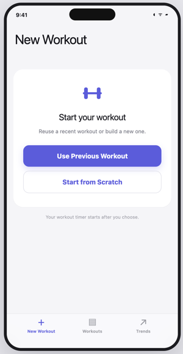
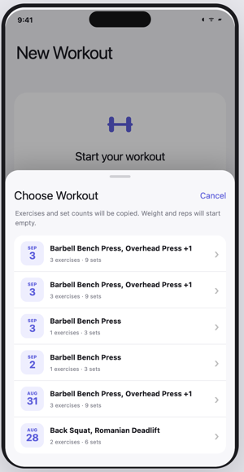
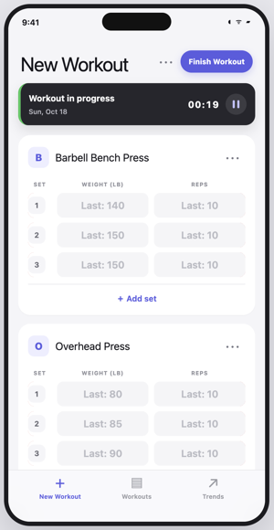
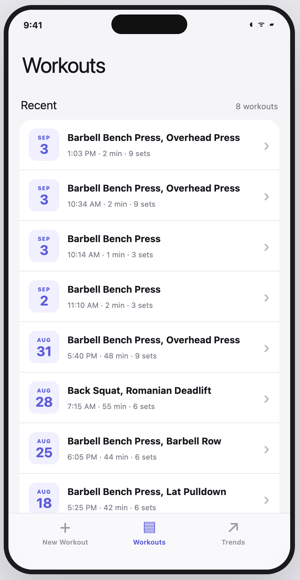
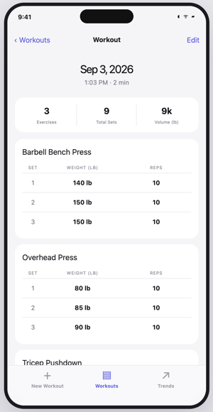
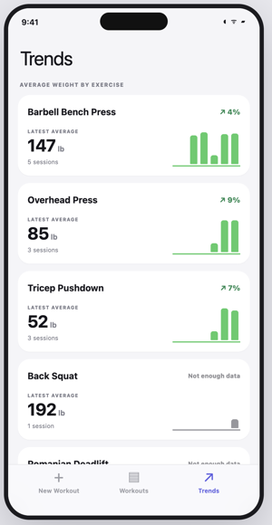
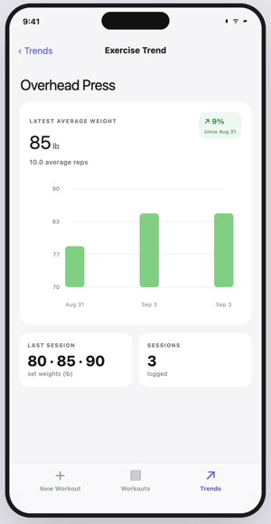

# Workout Tracker App

Workout Tracker is a simple app for logging strength training sessions and seeing progress over time. It is quick to set up and easy to use during a workout.

## Who Is It For?

Gym users generally fall into three groups:

1. **Beginners.** They are learning exercises and may want help choosing a workout.
2. **Intermediate users.** They know the main exercises and have a regular routine.
3. **Advanced users.** They know exactly how they want to train and care about tracking their performance.

Workout Tracker is for intermediate and advanced users. They already know what they want to do. They need a simple app that records their workouts and stays out of the way.

## What Do Users Want?

1. **Track each gym session.** Record weight, sets, and reps through a simple, user friendly screen.
2. **See progress over time.** Answer questions such as, “Is my bench press improving?”

Weight is the main progress measure. Reps provide extra context.

## What Is Wrong With Existing Workout Trackers?

1. **Too much setup.** Users must create programs, templates, or routines before they can start.
2. **Too clunky during a workout.** Users may have only a few seconds between sets to enter weight and reps.
3. **Too many subscriptions.** Almost every tracker tries to sell a recurring plan.
4. **Too much AI slop.** Apps create workouts and call them “personalized,” even when experienced users already know how they want to train.
5. **Basic tracking costs money.** Most established apps charge for features that should be simple and accessible.

## How Is This App Different?

1. **Almost no setup.** Start from scratch or reuse a previous workout.
2. **A simple interface that works.** The most important actions are easy to reach during a workout.
3. **No subscriptions or AI workouts.** The app tracks the workout chosen by the user. It does not try to sell a training plan.

## What Does the App Do?

1. **Start quickly.** Begin from scratch or copy the exercises and set counts from a previous workout.
2. **Record each session.** Enter weight and reps, add exercises or sets, pause the timer, and finish the workout.
3. **Review workout history.** See past exercises, sets, weights, reps, duration, and total volume. Correct past entries when needed.
4. **Track progress.** See the latest average weight, percentage change, session count, and progress chart for each exercise.

## App Screenshots

### New Workout

| Start a Workout | Reuse a Previous Workout | Track Weight, Sets, and Reps |
|:---:|:---:|:---:|
| [](docs/screenshots/start-workout.png) | [](docs/screenshots/choose-workout.png) | [](docs/screenshots/active-workout.png) |

### Workouts

| Review Workout History | Review a Completed Workout |
|:---:|:---:|
| [](docs/screenshots/workout-history.png) | [](docs/screenshots/workout-detail.png) |

### Trends

| Scan Progress by Exercise | Explore Detailed Progress |
|:---:|:---:|
| [](docs/screenshots/trends-overview.png) | [](docs/screenshots/exercise-trend.png) |

## Data

Workout data is stored on the current device. Each user has an independent set of workout data.

Clearing browser storage removes recorded workouts. Accounts, cloud sync, and access across devices are not available yet.

## Run the App Locally

### Requirements

You need Node.js 22.13 or newer and pnpm.

### Start the App

```bash
pnpm install
pnpm run dev
```

Open [http://localhost:3000](http://localhost:3000) in a browser.

### Check the Build

```bash
pnpm run build
```
